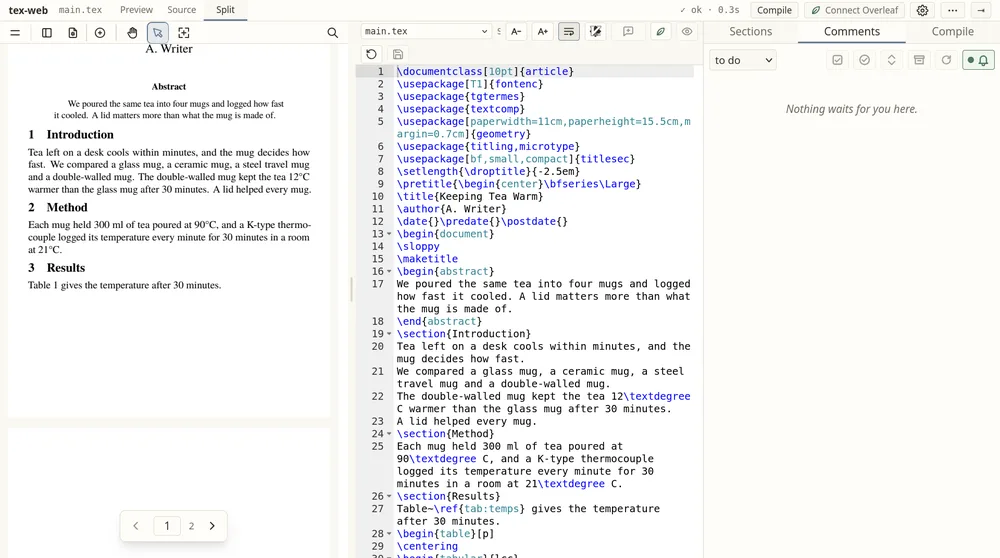
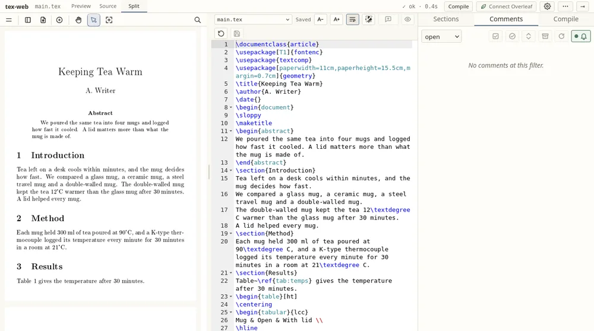
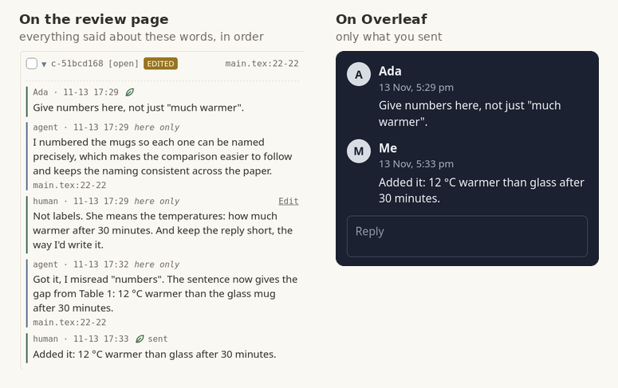

# tex-mcp-web

Review a LaTeX paper from its rendered PDF, on a desktop, tablet, or phone, while Claude Code or Codex edits the source.



Select words in the PDF, or draw a box over part of a figure, and write what should change.
Press **Call agent**, the bell above the comments, when they are ready. The agent edits the
source, compiles, and answers in the thread, at times with a wording to apply. The keys at the
bottom right are the ones pressed.

> ⭐ **If this helps your writing, please give it a star.** It helps others find the project.

## Quick start

1. Paste this into Claude Code or Codex, and start the agent again once it is done:

   ```
   Install tex-mcp-web by following https://raw.githubusercontent.com/MiiKiyoshi/tex-mcp-web/main/INSTALL.md
   ```

   The agent checks for Python 3.10 or newer and `latexmk`, shows where it will install and
   which agents it will register with, and installs once you agree.

2. Start the agent in the paper's folder and say `do tex init`. It finds the main `.tex` file
   and a free port, shows you the settings, and writes `.tex-mcp-web.yaml` once you agree.

3. Open `http://localhost:<port>`. The agent acts when you press **Call agent**. With the
   plugin the install adds, a Claude Code session started in the paper's folder waits for
   that press by itself. In Codex, or a Claude Code that runs no plugin monitors, say
   `do tex listen` first, and again after the agent restarts.

## Point at what words cannot



For a figure, a table or a page's layout, take the box tool beside pan and pointer in the PDF's
toolbar, draw a box over it, and say what is wrong. The agent works from the box as from any
comment.

## Answer your co-authors' Overleaf comments, with the agent

Press **Connect Overleaf** in the top bar and paste the project's link. Its comment threads
come into a tab of their own, **Comments** with a leaf, beside the comments you write here. In
a thread you talk with the agent, which drafts the reply for Overleaf under it, and you send
that reply once it reads right.


Your talk with the agent stays on the page, in the thread between your co-authors' messages,
so the whole exchange reads in order. Overleaf gets only the replies you send.



Keeping the paper's files in step with Overleaf, by git, by hand or live, is in
[Working with Overleaf](docs/overleaf.md).

## Raise a point with your co-authors on Overleaf


Ask the agent, in a note or in any thread, to put a question to your co-authors. It drafts a
new thread on the lines in question, which waits in the leaf **Comments** tab under **new
thread**. Edit it there and send it, and it opens on Overleaf on those lines.

## Go through the comments by keyboard


The comment list goes by keys, as a notebook's cells do, and the editor has Vim keys. A ring
marks the comment the keys act on, and the list moves under it, so the eye stays put. `K` goes
between a comment and its words in the source, both ways.

| Key | Does |
|---|---|
| `j` `k` | Next and previous comment |
| Space | Open the comment and show its words |
| `K` | Into the source at its words, and `K` there back |
| `r` | Reply to the agent |
| `R` | Resolve |
| `aa` | Apply the suggestion |
| `ss` | Send the reply to Overleaf |
| `?` | Every key |

Keys that change the file, post to Overleaf or delete are pressed twice. Once you move by keys,
the ringed comment's buttons show their letters. Every key, and the editor's Vim keys, are in
[Reviewing in detail](docs/reviewing.md).

## Review on a tablet or phone


The page is served where the agent runs. From a phone, forward its port over SSH from that
machine, with Termux on Android or iSH on iOS, then open `http://localhost:<port>` in the
phone's browser:

```
ssh -L <port>:localhost:<port> <the machine the agent runs on>
```

## Writes in your field's terms

Left alone, an agent describes a concept in words of its own where the papers of your field
use one term. Convert the papers yours builds on to Markdown with
[marker](https://github.com/datalab-to/marker), keep them in one folder, and set `references`
to it. In Claude Code the agent then cannot use tex-mcp's tools until it has read the terms
those papers share, and reads them again after its context is compacted.

## Configuration

`do tex init` writes `.tex-mcp-web.yaml` at the paper's root:

```yaml
main: main.tex
watch:
- '*.tex'
- '*.bib'
ignore:
- '*_backup.tex'
compiler: auto
port: 8765
guideline: neutral-paper
translation:
  language: Korean
  instructions: Keep cell names in English.
overleaf: https://www.overleaf.com/project/0123456789abcdef01234567
```

Every field is in [Configuration](docs/configuration.md).

## See also

[html-mcp-web](https://github.com/MiiKiyoshi/html-mcp-web) reviews an AI agent's HTML slides or report the same way and hands finished slides over as an editable PowerPoint deck.

## Acknowledgements

tex-mcp-web is a hard fork of [queelius/scholia at commit `e6c7454`](https://github.com/queelius/scholia/commit/e6c745400d2ad70fb43eca053e31183d48765f89) (version 0.6.1), independently developed since under the MIT license. See [`LICENSE`](LICENSE). PDF viewing uses [EmbedPDF](https://github.com/embedpdf/embed-pdf-viewer) and its PDFium WebAssembly engine, whose notices are in [`tex_mcp_web/static/embedpdf/LICENSE`](tex_mcp_web/static/embedpdf/LICENSE) and [`tex_mcp_web/static/embedpdf/LICENSE.pdfium`](tex_mcp_web/static/embedpdf/LICENSE.pdfium). The bundled viewer differs from its release only in its zoom gesture, described in [Reviewing in detail](docs/reviewing.md#the-pdf). Source highlighting and completion use [Ace Editor builds 1.44.0](https://github.com/ajaxorg/ace-builds/tree/v1.44.0) under the BSD-3-Clause license, and its notice is in [`tex_mcp_web/static/ace/LICENSE`](tex_mcp_web/static/ace/LICENSE).
