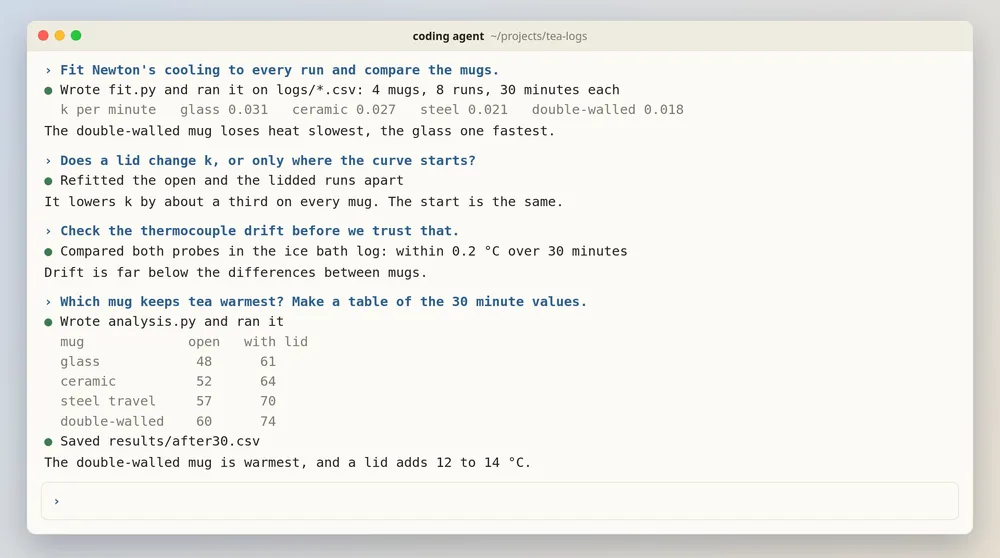
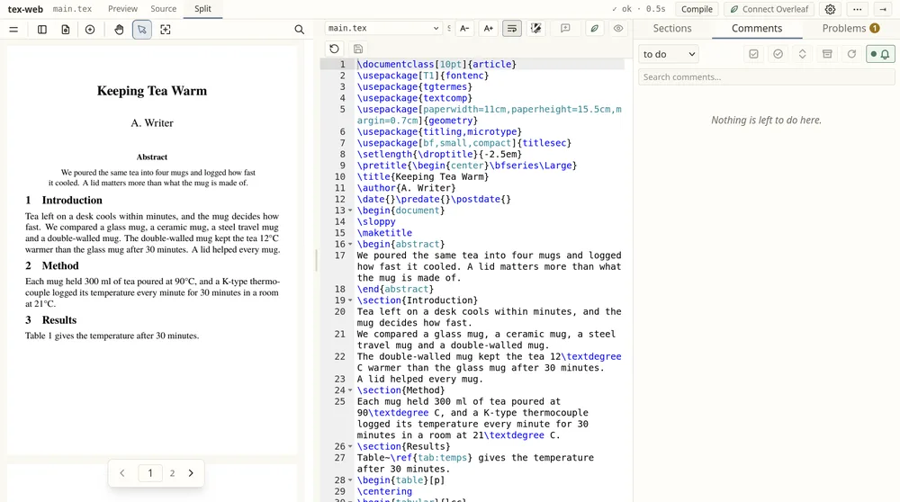
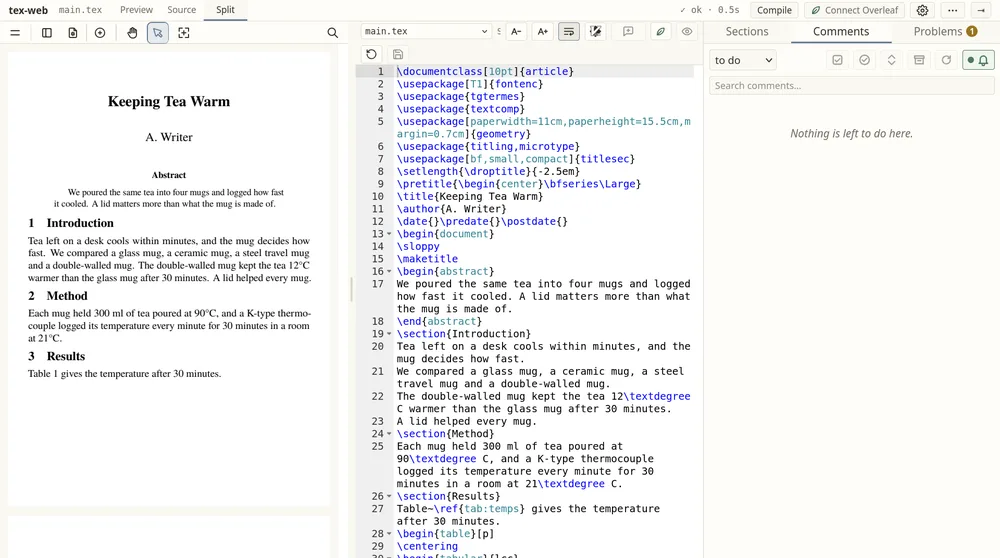
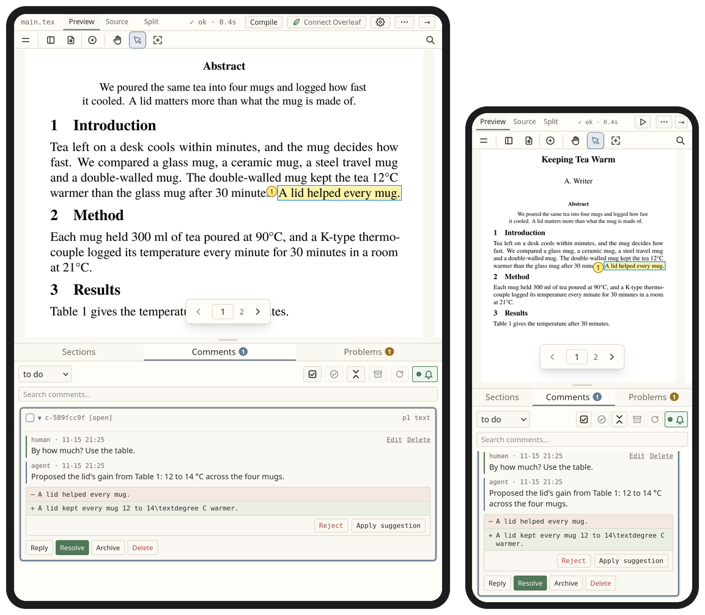

# tex-mcp-web

[](https://github.com/MiiKiyoshi/tex-mcp-web/actions/workflows/tests.yml)
[](LICENSE)
[](https://github.com/MiiKiyoshi/tex-mcp-web/releases/latest)
[](pyproject.toml)

**Your coding agent already did the research. Let it write, review and fix the paper in the same session.**

tex-mcp-web is an MCP server that adds a review page for LaTeX papers to Claude Code and Codex.
You comment on the compiled PDF from a desktop, tablet or phone, and the agent edits the LaTeX
source. It runs on Windows, macOS and Linux.

<picture>
  <source media="(prefers-color-scheme: dark)" srcset="docs/images/from-work-dark.webp">
  
</picture>

The agent session that produced your results already has the context needed to write about
them. Ask the agent to write the paper in a folder you choose, then say `do tex init`. The agent proposes settings for the review page, including the port and
whether the page should open only from a private link, and sets the page up for that folder
once you agree. Because the paper is written in the same session as the research, nothing has
to be copied into another tool. Comment on as many places as you like, then press
**Call agent** once. The agent handles all the comments in one turn and answers each one from
the work it has already done.

## Review from the PDF

<picture>
  <source media="(prefers-color-scheme: dark)" srcset="docs/images/pdf-review-dark.webp">
  
</picture>

Select words in the PDF, or draw a box over part of a figure, and write what should change.
When your comments are ready, press **Call agent**, the bell icon above the comment list. The
agent edits the source, compiles the paper and replies in each thread. Where the wording is
yours to decide, it proposes a change instead, which you can apply or reject. In the
recordings on this page, the keys being pressed appear in the bottom right corner.

> ⭐ **If this helps your writing, please give it a star.** It helps others find the project.

## Quick start

1. Paste this into Claude Code or Codex, and restart the agent when it is done:

   ```
   Install tex-mcp-web by following https://raw.githubusercontent.com/MiiKiyoshi/tex-mcp-web/main/INSTALL.md
   ```

   The agent checks your machine, tells you what it will do, and installs once you agree. This
   works the same way on Windows, macOS and Linux.

2. In the session where you are working, say `do tex init`. The paper can be in any folder,
   either one you already have or one you ask the agent to create. The agent finds the main
   `.tex` file and a free port, shows you the settings it proposes, and writes
   `.tex-mcp-web.yaml` once you agree.

3. Open the address the agent gives you, comment on the PDF, and press **Call agent**.

In later sessions, Claude Code started in the same folder listens for **Call agent** on its
own. In Codex, say `do tex listen` after the agent starts.

## Comment on figures and tables

<picture>
  <source media="(prefers-color-scheme: dark)" srcset="docs/images/pdf-area-dark.webp">
  
</picture>

A figure, a table or a page's layout often has no text you can select. For these, pick the box
tool next to the pan and pointer tools in the PDF toolbar, draw a box over the area and
describe the problem. The agent treats a box like any other comment.

## Fit the page limit

The **Problems** tab lists the build's errors and warnings, and below them shows where the body
of the paper ends, just before the bibliography: the page, the column, and how many more lines
fit in that column. It also lists each paragraph, list item or caption whose last line is
shorter than a quarter of the column. Clicking an entry marks that line in the PDF. The
agent's `compile()` tool reports the same list, so the agent can carry out a request like
`we are four lines over, pull up the short lines` and check the result itself.

## Answer your co-authors' Overleaf comments with the agent

Press **Connect Overleaf** in the top bar. Settings opens and asks for the project's link and,
the first time, your Overleaf session cookie. The project's comment threads then appear in a
tab of their own, **Comments** with a leaf icon, next to the tab for the comments you write on
the page. Within a thread you talk with the agent, which drafts the public reply in the box
below the thread, and you send that reply once you are happy with it.

Each tab opens on its **to do** view, which lists what is still pending: a comment the agent
has not answered, a suggestion to apply, a reply to send or a suggested edit to accept. The
number on the tab counts these items, and when it disappears, you are done.

<picture>
  <source media="(prefers-color-scheme: dark)" srcset="docs/images/overleaf-thread-dark.webp">
  
</picture>

Every entry in a thread is either **private** or **public**. A private entry stays on the page,
between you and the agent. A public entry is on Overleaf, where everyone in the project can
read it. Your conversation with the agent is private and appears in the thread between your
co-authors' public messages, so the whole exchange reads in order. Only the replies you send
reach Overleaf.

<picture>
  <source media="(prefers-color-scheme: dark)" srcset="docs/images/overleaf-thread-split-dark.png">
  
</picture>

While a page is open, your co-authors on Overleaf appear in the top bar and their cursors show
in the editor. Your cursor in the page's editor also appears on Overleaf, unless you choose
**Hidden** under **Your cursor on Overleaf** in Settings. [Working with Overleaf](docs/overleaf.md) covers
this and the ways to keep the paper's files in sync with Overleaf: through git, by hand or
live.

## Raise a point with your co-authors on Overleaf

<picture>
  <source media="(prefers-color-scheme: dark)" srcset="docs/images/new-thread-dark.webp">
  
</picture>

To start a thread, turn on the leaf button next to the comment button (the speech bubble) in
the editor toolbar, select words in the source, and press the comment button. Threads start
from the source because Overleaf attaches each thread to source text. The dialog that opens
has two boxes. In the lower one, a private note to the agent, describe what you want to raise,
as roughly as you like. The agent drafts the thread's first message in wording suited to your
co-authors, and you send it. The thread then appears on Overleaf, attached to those words, and
your note stays private. If you write the first message yourself in the upper box, it is
posted to Overleaf right away. You can also ask the agent, in any thread, to start a new
thread, and it drafts that one the same way.

## Accept or reject your co-authors' suggested edits

<picture>
  <source media="(prefers-color-scheme: dark)" srcset="docs/images/suggested-edits-dark.webp">
  
</picture>

Edits your co-authors make on Overleaf with track changes on arrive as suggested edits. Each
one appears as a card showing the removed and inserted text, and the editor marks it in the
source. **Accept** and **Reject**, or `aa` and `dd`, act on Overleaf for everyone in the
project.

## Work through comments from the keyboard

<picture>
  <source media="(prefers-color-scheme: dark)" srcset="docs/images/keyboard-dark.webp">
  
</picture>

You can move through the comment list with the keyboard, much as you move through the cells of
a notebook.
The editor also has Vim keys, which you turn on in the ⋯ menu of the editor toolbar. A ring
marks the comment the keys act on, and the list scrolls beneath it so your eyes can stay in
one place. `K` jumps between a comment and its words in the source, in either direction.

| Key | Action |
|---|---|
| `j` `k` | Next and previous comment |
| Space | Open the comment and show where it is in the PDF or the source |
| `K` | Jump to the comment's words in the source; press it there to come back |
| `r` | Reply privately to the agent |
| `R` | Resolve, or reopen a comment that is not open |
| `u` | Undo the last resolve, reopen or archive |
| `aa` | Apply the suggestion, or accept a suggested edit |
| `ss` | Send the reply to Overleaf |
| `/` | Search the comments |
| `?` | Show every key |

`nn` rejects a suggestion and `dd` deletes; like `aa` and `ss`, they are pressed twice. Once you
start moving with the keys, the buttons on the marked comment show their key letters. The search
box understands `from:`, `file:`, `after:` and `before:`, quoted phrases, `-` to exclude a
word, and `OR`. [Reviewing in detail](docs/reviewing.md) lists every key, including the
editor's Vim keys.

## Review on a tablet or phone

<picture>
  <source media="(prefers-color-scheme: dark)" srcset="docs/images/mobile-dark.png">
  
</picture>

The page is served from the machine where the agent runs. If that is your own computer, open
`http://localhost:8765`, or the port `do tex init` chose, and skip the rest of this section.
If the agent runs on a server you reach over SSH, forward the page's port to your computer.
On Windows, macOS and Linux alike, add the server once to `~/.ssh/config` (on Windows,
`C:\Users\<you>\.ssh\config`), using the port that `do tex init` wrote to
`.tex-mcp-web.yaml`:

```
Host paper-server
    HostName server.example.org
    User you
    LocalForward 8765 127.0.0.1:8765
```

Then, each time you work:

1. Run `ssh paper-server` in a terminal. The port stays forwarded as long as that connection
   is open.
2. Open `http://localhost:8765` in your computer's browser.

If you review papers on other ports, add a `LocalForward` line for each.

If the server is on a network you cannot reach from outside, such as at home or in an office,
[Tailscale](https://tailscale.com/docs/how-to/connect-to-devices) is an easy way in.
Install it on the server and on your computer, and the server gets a name you can reach from
anywhere. Put that name in `HostName`, and the steps above stay the same.

A phone works the same way. Termux on Android reads the same `~/.ssh/config`, and in Termius
on iOS you add the forward as a Local rule on the Port Forwarding screen. If the page token is
on, open the link that `tex-mcp-web link` prints on the server instead, once in each browser;
after that, the plain address works.

## Teach the agent your writing rules and terms

Rules you give an agent in conversation do not last. After its context has been compacted a
few times, it writes as if it had never heard them, and what Claude Code remembers for one
paper's folder does not carry over to the next paper in the same field. Rules and terminology
kept in files apply to every paper whose configuration points to them. In Claude Code, the agent cannot use
tex-mcp's tools until it has read these files, and it has to read them again after every
compaction. Codex does not enforce this yet.

Put your writing rules in a `GUIDELINE.md` file, in a folder of its own under
`~/.config/tex-mcp-web/guidelines/`, and set `guideline` to that folder's name. One guideline
can extend another, which keeps the rules for every paper separate from those for a single
field:

```
~/.config/tex-mcp-web/guidelines/
├── plain-writing/GUIDELINE.md    rules for every paper
└── my-field/GUIDELINE.md         rules for one field, starting with the lines below
```

```markdown
---
extends: plain-writing
---
```

With `guideline: my-field`, the agent reads plain-writing first and then my-field.

Left to itself, an agent also tends to describe a concept in its own words where the papers in
your field use an established term. Convert the papers your work builds on to Markdown with
[marker](https://github.com/datalab-to/marker), keep them in one folder, and set `references`
to that folder. The agent then reads the terms those papers use before it edits.

## Configuration

`do tex init` writes `.tex-mcp-web.yaml` in the folder where the agent was started. A typical
file looks like this:

```yaml
main: main.tex
watch:
- '*.tex'
- '*.bib'
ignore:
- '*_backup.tex'
compiler: auto
port: 8765
guideline: my-field
translation:
  language: Korean
  instructions: Keep technical terms in English.
overleaf: https://www.overleaf.com/project/0123456789abcdef01234567
```

With `translation` set, **Translation: Korean** in the ⋯ menu at the top of the page shows each
paragraph of the source in that language. The translation runs through a command line you
choose, set as `translation.command` here or, for every paper, in
`~/.config/tex-mcp-web/config.yaml`. If you ask your agent to set up translation, it proposes
a command and tests it. [Configuration](docs/configuration.md) describes every field.

## See also

[html-mcp-web](https://github.com/MiiKiyoshi/html-mcp-web) reviews an AI agent's HTML slides or reports the same way, and exports finished slides as an editable PowerPoint deck.

## Acknowledgements

tex-mcp-web is a hard fork of [queelius/scholia at commit `e6c7454`](https://github.com/queelius/scholia/commit/e6c745400d2ad70fb43eca053e31183d48765f89) (version 0.6.1) and has been developed independently since then under the MIT license; see [`LICENSE`](LICENSE). The PDF viewer is [EmbedPDF](https://github.com/embedpdf/embed-pdf-viewer) with its PDFium WebAssembly engine, whose notices are in [`tex_mcp_web/static/embedpdf/LICENSE`](tex_mcp_web/static/embedpdf/LICENSE) and [`tex_mcp_web/static/embedpdf/LICENSE.pdfium`](tex_mcp_web/static/embedpdf/LICENSE.pdfium). The bundled viewer differs from the release only in its zoom gesture, which is described in [Reviewing in detail](docs/reviewing.md#the-pdf). Syntax highlighting and completion in the source editor use [Ace Editor builds 1.44.0](https://github.com/ajaxorg/ace-builds/tree/v1.44.0) under the BSD-3-Clause license, and its notice is in [`tex_mcp_web/static/ace/LICENSE`](tex_mcp_web/static/ace/LICENSE).

<!-- mcp-name: io.github.MiiKiyoshi/tex-mcp-web -->
