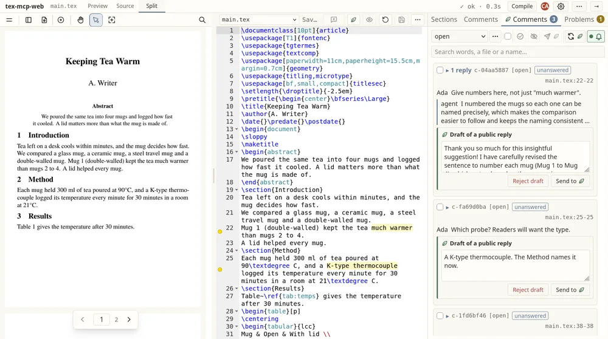
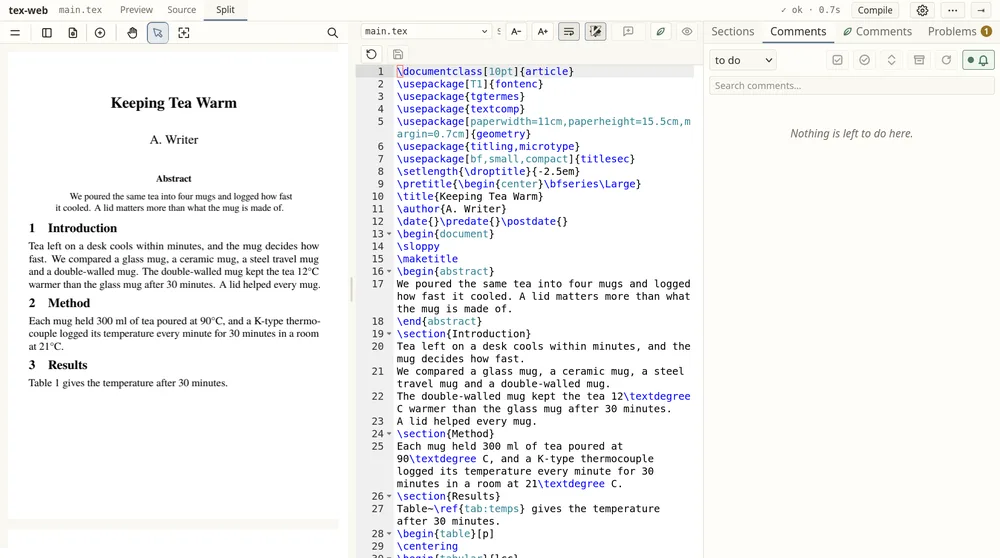
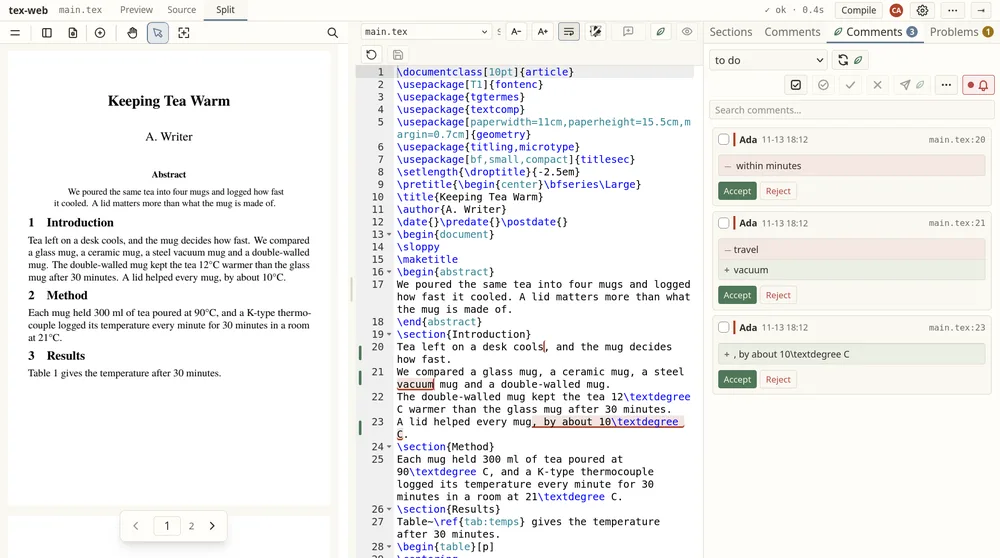
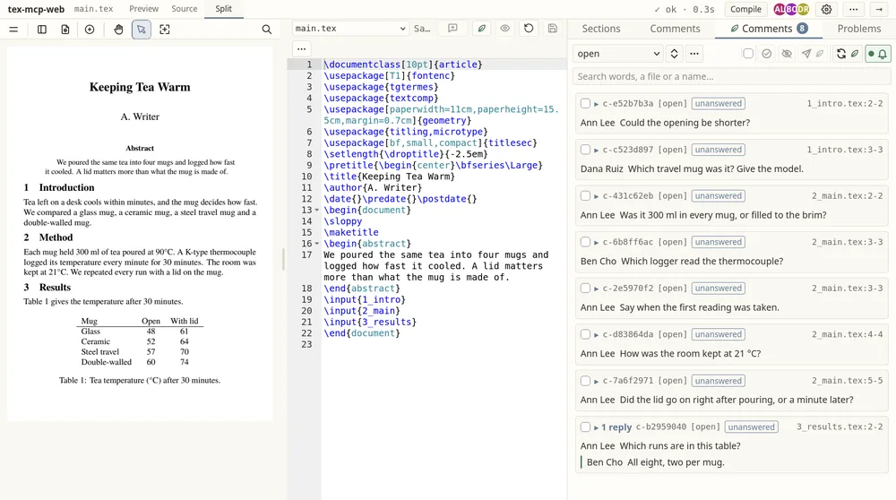
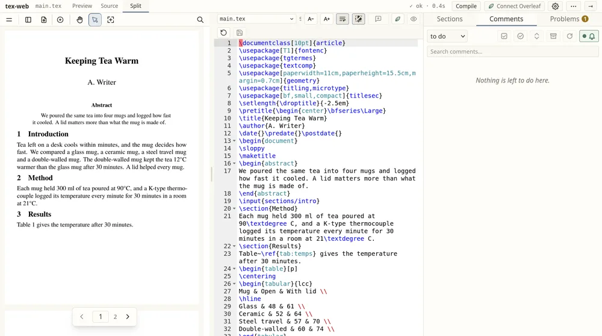

# tex-mcp-web

[](https://github.com/MiiKiyoshi/tex-mcp-web/actions/workflows/tests.yml)
[](LICENSE)
[](https://github.com/MiiKiyoshi/tex-mcp-web/releases/latest)
[](pyproject.toml)

**Your coding agent already did the research. Let it write, review and fix the paper in the same session.**

tex-mcp-web is an MCP server that adds a review page for LaTeX papers to Claude Code and Codex.
You comment on the compiled PDF, and the agent edits the LaTeX source. It runs on Windows,
macOS and Linux.

<picture>
  <source media="(prefers-color-scheme: dark)" srcset="docs/images/from-work-dark.webp">
  
</picture>

The session that produced your results writes the paper, so nothing is copied into another
tool. You select words in the PDF, write what should change, and press **Call agent** once for
all comments. The agent edits the source, compiles, and replies in each thread. Where the
wording is yours to decide, it proposes a change that you apply or reject. The recordings show
the pressed keys in the bottom right corner.

> ⭐ **If this helps your writing, please give it a star.** It helps others find the project.

## Quick start

1. Paste this into Claude Code or Codex, and restart the agent when it is done:

   ```
   Install tex-mcp-web by following https://raw.githubusercontent.com/MiiKiyoshi/tex-mcp-web/main/INSTALL.md
   ```

   The agent says what it will install and installs once you agree.

2. Say `do tex init` in the session where you work. The agent finds the main `.tex` file and a
   free port, and writes `.tex-mcp-web.yaml` once you agree.

3. Open the address the agent gives, comment on the PDF, and press **Call agent**. For an agent
   on a server, see [Open the page from another device](#open-the-page-from-another-device).

In later sessions, Claude Code started in the same folder listens for **Call agent**. In Codex,
say `do tex listen`.

## Comment on figures and tables

<picture>
  <source media="(prefers-color-scheme: dark)" srcset="docs/images/pdf-area-dark.webp">
  
</picture>

The box tool in the PDF toolbar comments on an area with no text to select, such as a figure,
a table or a page's layout. The agent treats a box like any other comment.

## Fit the page limit

The **Problems** tab shows where the body ends: the page, the column, and the lines left in
that column. It also lists each paragraph, list item or caption whose last line is shorter
than a quarter of the column. The agent's `compile()` reports the same list, so the agent can
carry out `we are four lines over, pull up the short lines` and check the result.

## Work with co-authors on Overleaf

**Connect Overleaf** in the top bar asks for the project's link and, the first time, your
Overleaf session cookie. The project's threads then appear in their own tab, **Comments** with
a leaf icon. [Working with Overleaf](docs/overleaf.md) covers the tab and the ways to sync the
files: git, by hand or live.

### Answer their comments with the agent

<picture>
  <source media="(prefers-color-scheme: dark)" srcset="docs/images/overleaf-thread-dark.webp">
  
</picture>

In a thread you talk with the agent, and the agent drafts the public reply. You send the reply
when it reads right. A **private** entry stays on the page, between you and the agent, and a
**public** entry is on Overleaf. Only the replies you send reach Overleaf. A thread whose last
message is a co-author's is marked **unanswered**.

<picture>
  <source media="(prefers-color-scheme: dark)" srcset="docs/images/overleaf-thread-split-dark.png">
  
</picture>

### Raise a point with them

<picture>
  <source media="(prefers-color-scheme: dark)" srcset="docs/images/new-thread-dark.webp">
  
</picture>

Overleaf attaches a thread to source text, so a new thread starts in the source. Turn on the
leaf button in the editor toolbar, select words, and press the comment button. A private note
in the lower box tells the agent what to raise, and the agent drafts the first message for you
to send. A first message written in the upper box is posted at once.

### Accept or reject their suggested edits

<picture>
  <source media="(prefers-color-scheme: dark)" srcset="docs/images/suggested-edits-dark.webp">
  
</picture>

Edits made on Overleaf with track changes on arrive as suggested edits. Each card shows the
removed and inserted text, and the editor marks it in the source. **Accept** and **Reject**, or
`aa` and `dd`, act on Overleaf for everyone.

### Find a co-author's comment

<picture>
  <source media="(prefers-color-scheme: dark)" srcset="docs/images/search-dark.webp">
  
</picture>

The search narrows the list to one thread, such as the one a co-author left on 2_main.tex on a
given morning. It takes `from:`, `file:`, `after:`, `before:`, quoted phrases, `-word` and
`OR`.

## Work through comments from the keyboard

<picture>
  <source media="(prefers-color-scheme: dark)" srcset="docs/images/keyboard-dark.webp">
  
</picture>

The keys move through the comment list as through the cells of a notebook, and a ring marks
the comment they act on. The editor has Vim keys, turned on in its ⋯ menu.

| Key | Action |
|---|---|
| `j` `k` | Next and previous comment |
| Space | Open the comment and show where it is in the PDF or the source |
| `K` | Jump to the comment's words in the source; press it there to come back |
| `r` | Reply privately to the agent |
| `R` | Resolve, or reopen a comment that is not open |
| `u` | Undo the last resolve, reopen or archive |
| `aa` | Apply the suggestion, or accept a suggested edit |
| `ss` | Send the reply to Overleaf |
| `/` | Search the comments |
| `?` | Show every key |

[Reviewing in detail](docs/reviewing.md) lists every key.

## Read the paper in your language

<picture>
  <source media="(prefers-color-scheme: dark)" srcset="docs/images/translation-dark.webp">
  
</picture>

With `translation` set, **Translation: Korean** in the ⋯ menu shows each paragraph of the
source in that language under the PDF. The translation runs through a command line you choose,
set as `translation.command`. The agent proposes and tests a command when you ask it to set up
translation.

## Teach the agent your writing rules and terms

Rules given in conversation are lost after a few compactions and do not reach the next paper.
Rules kept in files apply to every paper whose configuration names them. In Claude Code, the
agent reads them before it can use tex-mcp's tools, and again after every compaction. Codex
does not enforce this yet.

The rules go in `~/.config/tex-mcp-web/guidelines/<name>/GUIDELINE.md`, and `guideline: <name>`
selects them. A guideline whose front matter is `extends: <other>` is read after the other,
which separates the rules for every paper from those of one field.

`references` names a folder of the papers yours builds on, converted to Markdown with
[marker](https://github.com/datalab-to/marker). The agent reads the terms those papers use
before it edits.

## Open the page from another device

<picture>
  <source media="(prefers-color-scheme: dark)" srcset="docs/images/mobile-dark.png">
  
</picture>

The page is served from the machine where the agent runs, at `http://localhost:8765` or the
port `do tex init` chose. For an agent on a server, forward the port in `~/.ssh/config`:

```
Host paper-server
    HostName server.example.org
    User you
    LocalForward 8765 127.0.0.1:8765
```

While `ssh paper-server` is connected, `http://localhost:8765` opens the page. Termux on
Android reads the same file, and Termius on iOS takes the forward as a Local rule.
[Tailscale](https://tailscale.com/docs/how-to/connect-to-devices) reaches a server on a home or
office network. With the page token on, open the link that `tex-mcp-web link` prints once in
each browser.

## Configuration

`do tex init` writes `.tex-mcp-web.yaml` in the folder where the agent was started:

```yaml
main: main.tex
compiler: auto
port: 8765
guideline: my-field
translation:
  language: Korean
overleaf: https://www.overleaf.com/project/0123456789abcdef01234567
```

[Configuration](docs/configuration.md) describes every field.

## See also

[html-mcp-web](https://github.com/MiiKiyoshi/html-mcp-web) reviews an AI agent's HTML slides or reports the same way, and exports finished slides as an editable PowerPoint deck.

## Acknowledgements

tex-mcp-web is a hard fork of [queelius/scholia at commit `e6c7454`](https://github.com/queelius/scholia/commit/e6c745400d2ad70fb43eca053e31183d48765f89) (version 0.6.1) and has been developed independently since then under the MIT license; see [`LICENSE`](LICENSE). The PDF viewer is [EmbedPDF](https://github.com/embedpdf/embed-pdf-viewer) with its PDFium WebAssembly engine, whose notices are in [`tex_mcp_web/static/embedpdf/LICENSE`](tex_mcp_web/static/embedpdf/LICENSE) and [`tex_mcp_web/static/embedpdf/LICENSE.pdfium`](tex_mcp_web/static/embedpdf/LICENSE.pdfium). The bundled viewer differs from the release only in its zoom gesture, which is described in [Reviewing in detail](docs/reviewing.md#the-pdf). Syntax highlighting and completion in the source editor use [Ace Editor builds 1.44.0](https://github.com/ajaxorg/ace-builds/tree/v1.44.0) under the BSD-3-Clause license, and its notice is in [`tex_mcp_web/static/ace/LICENSE`](tex_mcp_web/static/ace/LICENSE).

<!-- mcp-name: io.github.MiiKiyoshi/tex-mcp-web -->
