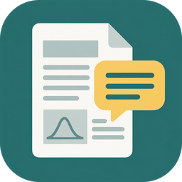
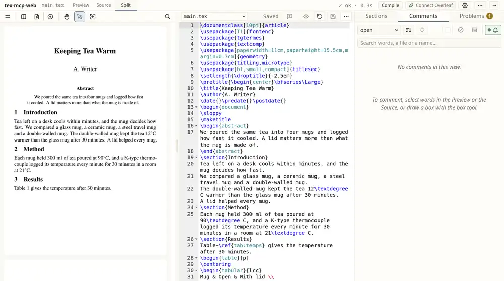
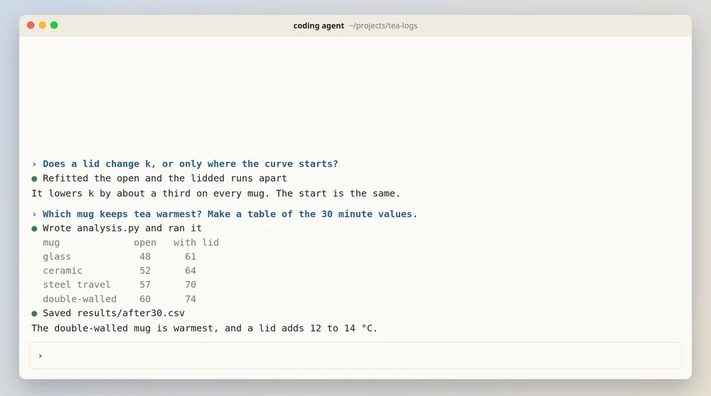
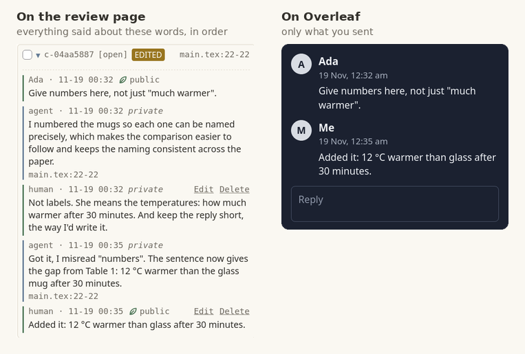
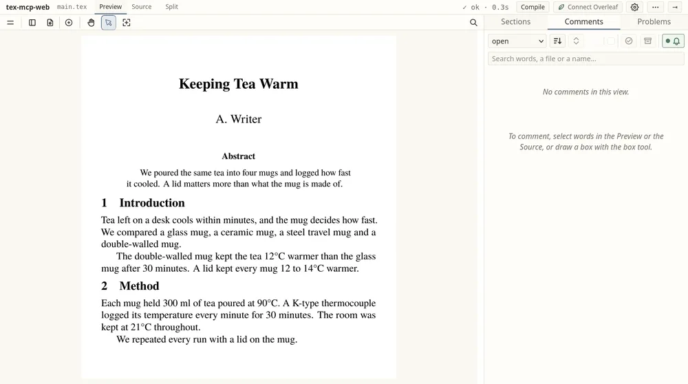

# tex-mcp-web

[](https://github.com/MiiKiyoshi/tex-mcp-web/actions/workflows/tests.yml)
[](LICENSE)
[](https://github.com/MiiKiyoshi/tex-mcp-web/releases/latest)
[](pyproject.toml)

**Comment on your paper's PDF, and the coding agent that did the research fixes the LaTeX.**

tex-mcp-web adds a review page for LaTeX papers to Claude Code and Codex. You open the page in
a browser and comment on the PDF, and the agent edits the source. It runs on Windows, macOS and
Linux.

<picture>
  <source media="(prefers-color-scheme: dark)" srcset="docs/images/review-dark.webp">
  
</picture>

Select words in the PDF, or draw a box over a figure or a table, and write what should change.
**Call agent** sends all your comments at once. The agent edits the source, builds the PDF
again and answers each comment. For a change of wording it shows the old and the new text, and
you apply or reject it.

The agent is the session you already work in. It wrote the code and ran the experiments, so it
answers from that work, and nothing is copied into another tool.

## Quick start

1. Paste this into Claude Code or Codex, and restart the agent when it is done:

   ```
   Install tex-mcp-web by following https://raw.githubusercontent.com/MiiKiyoshi/tex-mcp-web/main/INSTALL.md
   ```

   The agent says what it will install and installs once you agree.

2. Say `do tex init` in the session where you work. The agent finds the main `.tex` file,
   proposes the settings, and saves them once you agree.

3. Open the address the agent gives, comment on the PDF, and press **Call agent**.

<picture>
  <source media="(prefers-color-scheme: dark)" srcset="docs/images/setup-dark.webp">
  
</picture>

You need Python 3.10 or newer and a LaTeX installation with `latexmk`. The agent checks both
and asks before it installs anything.

The page is served from your own machine and answers only to it. Your comments are kept in the
paper's folder. The page contacts three places: Overleaf when you connect it, the translation
program when you set one, and the package index once a day for a newer release.

## Work with co-authors on Overleaf

<picture>
  <source media="(prefers-color-scheme: dark)" srcset="docs/images/overleaf-thread-dark.webp">
  
</picture>

**Connect Overleaf** asks for the project's link and, once, your Overleaf sign-in cookie. Your
co-authors' comments then appear on the page. Under each comment you talk with the agent in
private, and the agent drafts the reply. Only the reply you send appears on Overleaf.

<picture>
  <source media="(prefers-color-scheme: dark)" srcset="docs/images/overleaf-thread-split-dark.png">
  
</picture>

The agent also turns a rough note into a new comment for your co-authors. Edits they suggest
on Overleaf are accepted or rejected here. A search finds one comment by its writer, its file
and its date. [Working with Overleaf](docs/overleaf.md) shows each of these, and how the files
stay in sync with Overleaf.

## Read the paper in your language

<picture>
  <source media="(prefers-color-scheme: dark)" srcset="docs/images/translation-dark.webp">
  
</picture>

The page shows each paragraph in your language under the PDF. A click on a translated
paragraph opens its lines in the source, and the paragraph you edit stays highlighted. You
choose the program that translates, so you choose the model and the cost.
[Translation](docs/reviewing.md#translation) describes the setup.

## More

- **Page limit.** The agent sees where the text ends and how many lines are left, so it can
  shorten the paper to fit and check the result. [Problems](docs/reviewing.md#problems)
  describes the list.
- **Writing rules.** The agent reads your rules from a file before it edits, in every paper
  that names the file. [Configuration](docs/configuration.md) describes `guideline` and
  `references`.
- **Keyboard.** Every step works without the mouse, and the editor has Vim keys.
  [Comment keys](docs/reviewing.md#comment-keys) lists them.
- **Tablet and phone.** The page works by touch.
  [Opening the page from another device](docs/reviewing.md#opening-the-page-from-another-device)
  also covers an agent that runs on a server.
- **Settings.** `do tex init` saves them in `.tex-mcp-web.yaml`.
  [Configuration](docs/configuration.md) describes every field.

> ⭐ **If this helps your writing, please give it a star.** It helps others find the project.

## See also

[html-mcp-web](https://github.com/MiiKiyoshi/html-mcp-web) reviews an AI agent's HTML slides or reports the same way, and exports finished slides as an editable PowerPoint deck.

## Acknowledgements

tex-mcp-web is a hard fork of [queelius/scholia at commit `e6c7454`](https://github.com/queelius/scholia/commit/e6c745400d2ad70fb43eca053e31183d48765f89) (version 0.6.1) and has been developed independently since then under the MIT license; see [`LICENSE`](LICENSE). The PDF viewer is [EmbedPDF](https://github.com/embedpdf/embed-pdf-viewer) with its PDFium WebAssembly engine, whose notices are in [`tex_mcp_web/static/embedpdf/LICENSE`](tex_mcp_web/static/embedpdf/LICENSE) and [`tex_mcp_web/static/embedpdf/LICENSE.pdfium`](tex_mcp_web/static/embedpdf/LICENSE.pdfium). The bundled viewer differs from the release only in its zoom gesture, which is described in [Reviewing in detail](docs/reviewing.md#the-pdf). Syntax highlighting and completion in the source editor use [Ace Editor builds 1.44.0](https://github.com/ajaxorg/ace-builds/tree/v1.44.0) under the BSD-3-Clause license, and its notice is in [`tex_mcp_web/static/ace/LICENSE`](tex_mcp_web/static/ace/LICENSE).

<!-- mcp-name: io.github.MiiKiyoshi/tex-mcp-web -->
