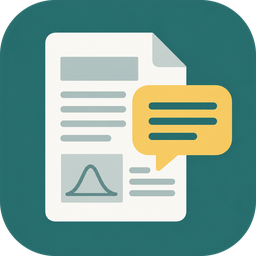
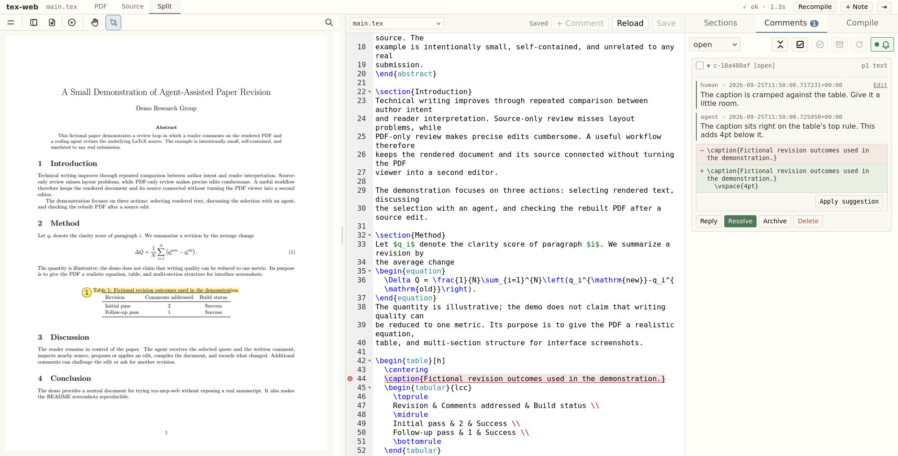
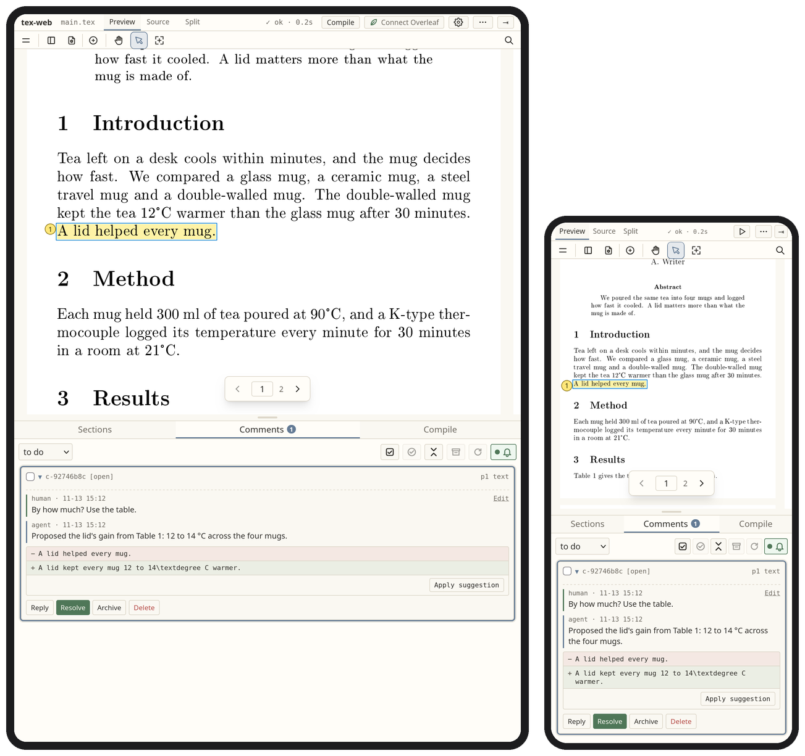

# tex-mcp-web

Review a LaTeX paper from its rendered PDF, on a desktop, tablet, or phone, while Claude Code or Codex edits the source.

> ⭐ **If this helps your writing, please give it a star.** It helps others find the project.



## Writes in your field's terms

Left alone, an agent describes a concept in words of its own where the papers of your field
use one term. Give tex-mcp those papers and, in Claude Code, its tools stay locked until the
agent has read the terms they share, and they lock again after every compaction.

To set it up, convert the papers yours builds on to Markdown with
[marker](https://github.com/datalab-to/marker), keep them in one folder, and set `references`
to it.

## Install

Paste this into Claude Code or Codex:

```
Install tex-mcp-web by following https://raw.githubusercontent.com/MiiKiyoshi/tex-mcp-web/main/INSTALL.md
```

The agent checks for Python 3.10 or newer and `latexmk`, shows where it will install and
which agents it will register with, and installs once you agree. Start the agent again
afterwards.

## Init

Once per paper, start the agent in the paper's folder and say:

```
do tex init
```

The agent finds the main `.tex` file and a free port, shows you the settings, and writes
`.tex-mcp-web.yaml` once you agree. A folder that already has one keeps it.

## Listen

To review, say:

```
do tex listen
```

Open `http://localhost:<port>` with the port you chose at init. The agent serves the page,
so there is nothing else to start. Say it again after the agent restarts.

## Reviewing

- Drag over PDF text and write what should change. Add a suggested wording in the
  replacement box when you have one.
- **Source** beside **Comment** on a PDF selection selects the same words in the source
  editor, at the lines SyncTeX names, or those lines when a macro prints the words. The other
  way, **→ Preview** beside **+ Comment** in the editor's bar marks where the Preview prints
  the selected words. Either turns the view to Split. Both need a PDF built with SyncTeX,
  which **Compile** builds. Cmd (macOS) or Ctrl with a double click on a PDF word does what
  **Source** does for that word.
- The box tool, beside pan and pointer in the PDF's toolbar, turns a drag on the PDF into a
  box to comment on what has no text to select, such as part of a figure. The box holds
  while a compile leaves what it covers as it was.
- **+ Note** comments on the whole paper, and the **Sections** tab comments on a section.
  You can also select text in the Source tab and press **+ Comment**.
- Press **Call agent**, the bell in the Comments tab, when your comments are ready. The
  listening agent edits the source, compiles, and replies in the same thread. Without
  listen, ask the agent in chat to handle the tex comments.
- **Resolve** a thread whose edit satisfies you, or **Reply** in it when it does not.
  **Archive** sets a thread aside, and it still takes replies.
- Edits in the Source tab are saved when you press **Save**.
- With `translation` set, the language's button shows the source translated under the
  Preview or the editor. In Split, the menu beside the view tabs puts it under the Preview,
  under Source, beside Source, or instead of Source. The grips between panes are dragged to
  share the room, each place keeps its own share, and the page remembers both.

## Suggested edits

The thread shows the source lines the agent would change as a −/+ pair, and the Source tab
marks the same text in red. **Apply suggestion** writes the change into the file. Proposing
again replaces the proposal.

## On a tablet or phone



Forward the port you chose at init over SSH, from Termux on Android or iSH on iOS, then open
`http://localhost:<port>` in the phone's browser.

```
ssh -L <port>:localhost:<port> <server>
```

## Configuration

Edit `.tex-mcp-web.yaml` at the paper's root. A saved change applies at once, except `port`
and `dir`, which apply when Claude Code or Codex restarts.

```yaml
main: main.tex
watch:
- '*.tex'
- '*.bib'
ignore:
- '*_backup.tex'
compiler: auto
port: 8765
translation:
  language: Korean
  instructions: Keep cell names in English.
```

| Field | Effect |
|---|---|
| `main` | Top-level source file compiled into the PDF. |
| `dir` | Folder holding the paper, relative to this file or absolute. Unset means this file's folder. |
| `watch` | Source files the Source tab offers. |
| `ignore` | Patterns excluded even when they match `watch`. |
| `compiler` | `auto` (latexmk for LaTeX, pandoc for Markdown or text), `latexmk`, `pdflatex`, `xelatex`, `lualatex`, or `pandoc`. |
| `port` | This paper's review page port. Any free port works. Init picks the first free one from 8765, so each paper can have its own. |
| `references` | Folder holding only the papers yours builds on, converted to Markdown, relative to this file or absolute. Unset means no list of their terms. |
| `translation` | `language` puts a button for that language beside **+ Note**: it shows each paragraph of the source translated by `claude -p`, with those on the current page marked. `instructions` adds rules for the translator, one per line. A paragraph is translated once per text. Unset means no translation. |

## See also

[html-mcp-web](https://github.com/MiiKiyoshi/html-mcp-web) reviews an AI agent's HTML slides or report the same way and hands finished slides over as an editable PowerPoint deck.

## Acknowledgements

tex-mcp-web is a hard fork of [queelius/scholia at commit `e6c7454`](https://github.com/queelius/scholia/commit/e6c745400d2ad70fb43eca053e31183d48765f89) (version 0.6.1), independently developed since under the MIT license. See [`LICENSE`](LICENSE). PDF viewing uses [EmbedPDF](https://github.com/embedpdf/embed-pdf-viewer) and its PDFium WebAssembly engine, whose notices are in [`tex_mcp_web/static/embedpdf/LICENSE`](tex_mcp_web/static/embedpdf/LICENSE) and [`tex_mcp_web/static/embedpdf/LICENSE.pdfium`](tex_mcp_web/static/embedpdf/LICENSE.pdfium). Source highlighting uses [Ace Editor builds 1.44.0](https://github.com/ajaxorg/ace-builds/tree/v1.44.0) under the BSD-3-Clause license, and its notice is in [`tex_mcp_web/static/ace/LICENSE`](tex_mcp_web/static/ace/LICENSE).
