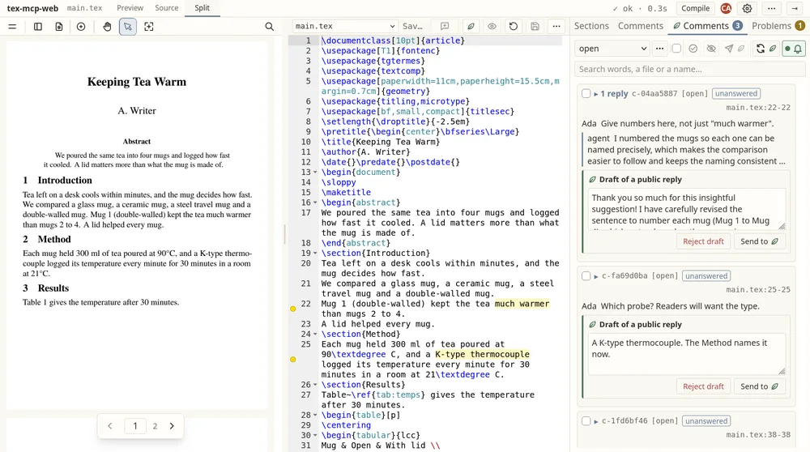
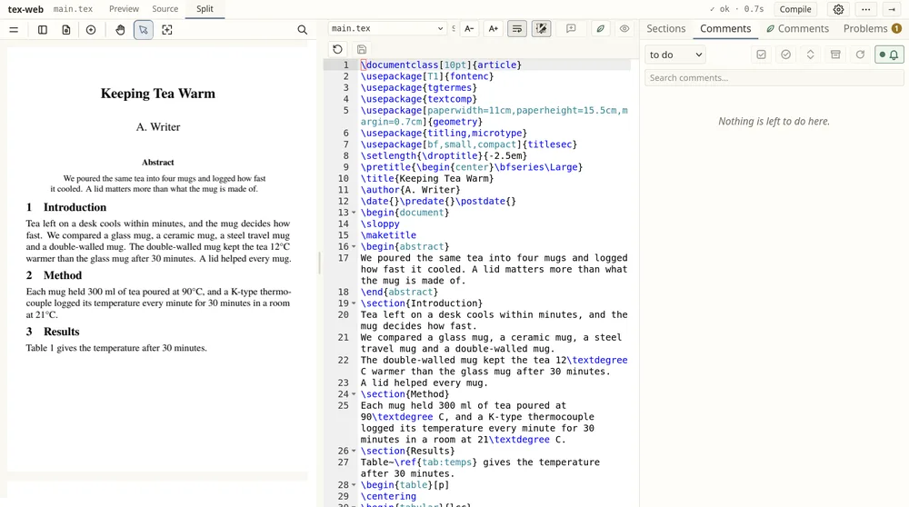
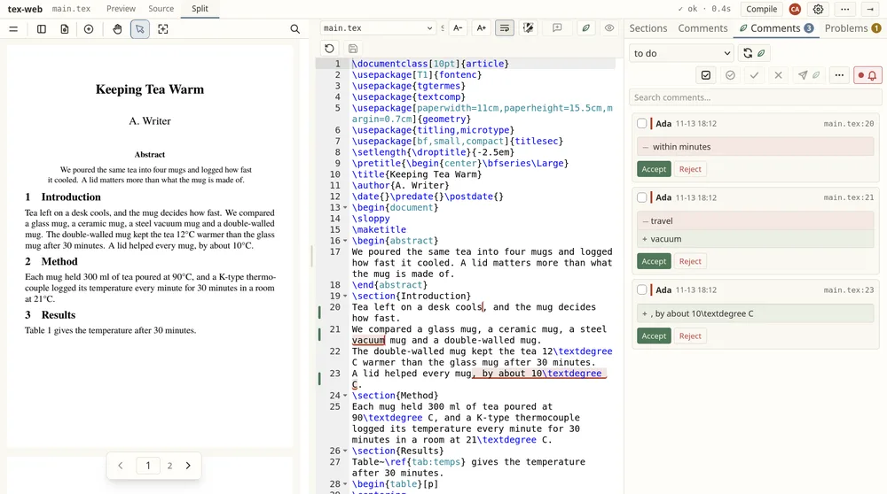

# Working with Overleaf

The review page can follow the paper's Overleaf project. The project's comment threads and
suggested edits appear in a tab of their own, your co-authors appear in the top bar, and the
paper's files stay in sync with the project in one of three ways.

## Connecting

`do tex init` asks whether the paper is on Overleaf. Give the agent the project's link
(`https://www.overleaf.com/project/…`) and choose how the files sync, and the agent saves
both. A folder without the paper gets its files from Overleaf, so nothing is downloaded by
hand.

On the page, **Connect Overleaf** in the top bar and **Settings** take the same link. The
page saves it in `.tex-mcp-web.yaml` as `overleaf:`, and **Disconnect** in Settings removes
it. Both accept only links on overleaf.com, so the link to a project on another Overleaf
server must be written into the file by hand.

The page reads Overleaf with your session cookie, `overleaf_session2`, which you copy once
from the browser's developer tools and paste into the page, not into the chat with the agent.

1. Sign in to Overleaf in your browser.
2. Open the developer tools and go to the cookies of overleaf.com, as your browser's own
   guide shows: [Chrome](https://developer.chrome.com/docs/devtools/application/cookies),
   [Edge](https://learn.microsoft.com/en-us/microsoft-edge/devtools/storage/cookies) or
   [Firefox](https://firefox-source-docs.mozilla.org/devtools-user/storage_inspector/cookies/index.html).
   In Safari, [turn on Web Inspector](https://webkit.org/web-inspector/enabling-web-inspector/)
   first, then open its Storage tab.
3. Copy the value of `overleaf_session2`, paste it under **Connect Overleaf** or in
   **Settings**, and press **Save**.

The cookie is
saved in `~/.config/tex-mcp-web/overleaf-cookie`, which only you can read, and is used for
every paper. The environment variable `TEX_MCP_WEB_OVERLEAF_COOKIE` can supply it instead and
takes precedence.

The cookie signs in as you, so the page sends it only to the server in the project's link,
only over https (plain http only to this machine), and never to a place that server redirects
to. git pull and git push use your own git credentials. The page never sends the cookie back
to the browser, and Settings shows only where it comes from.

The page answers only at `localhost` or `127.0.0.1` on this machine, and only its own pages,
so other websites in your browser cannot act through it. As with any local server, other
accounts on the same machine can still reach its port and act as you through it. On a shared
machine, set `page_token: true` in the [configuration](configuration.md) so that the page
answers only a browser that opened its link with your token. A browser sends that token to
every port of the address, so don't open other accounts' pages in a browser on that machine.

## Comment threads

- Threads from Overleaf appear in the leaf **Comments** tab next to the first **Comments**
  tab, in the order of the paper unless the sort list says otherwise (see
  [Threads](reviewing.md#threads)).
- The tab opens on **open**, which lists the open threads and, after them, the suggested edits
  waiting for you to accept or reject. A thread is unanswered when its last message on
  Overleaf is from someone else. The **unanswered** view lists only those threads, and the
  number on the tab counts them with the suggested edits. A reply sent from here, or written
  on Overleaf under your name, answers a thread. A new thread not sent yet has no message, so
  it is simply open.
- The **drafts** view lists the threads with something not yet sent to Overleaf, new threads
  first and then threads with a drafted reply, each group in the order the sort list sets. A
  reply leaves the view once you send it or reject its draft. A new thread stays until you
  send or delete it. The other views are **suggested edits**, **hidden**, **resolved** and
  **all**.
- The sync button with the leaf, above the list, brings in new open threads from Overleaf,
  with their replies, on the words they were written about. While a page is open, a new thread
  on Overleaf is counted on that button within seconds, and threads already here are updated
  automatically when they change there. Because a thread is attached to words, comments sync
  only when the folder and Overleaf have the same files. Until then, the tab says above the
  list what is in the way, and the button is grayed out. When files sync live, there is no
  button, and new threads come in automatically whenever every file is in sync.
- In a file whose text matches Overleaf's exactly, a thread sits where Overleaf has it and
  moves when Overleaf moves it. In a file that differs, it stays on its words as this file is
  edited. A thread whose words are not yet in the file here is attached to the paper as a
  whole, with its place on Overleaf shown under it, until the words arrive.
- A thread is open, resolved or deleted here as it is on Overleaf. **Resolve** and **Reopen**
  change the thread on Overleaf first, for everyone in the project, and then here. If Overleaf
  refuses, nothing changes. Resolving or reopening several threads at once asks you to confirm
  first. **Undo** reverses the change on Overleaf too, without asking. Overleaf has no
  archive, so the leaf tab has no **Archive**, and a thread already on Overleaf has no
  **Delete** button on its card. A message edited or deleted on Overleaf is edited or deleted
  here, a thread deleted there is deleted here, and a thread removed only from this page is
  brought back.
- **Hide**, on a card or for the selected threads, puts a thread out of the way on this page
  only. Nothing is sent to Overleaf, where the thread stays open for everyone. A hidden thread
  is left out of **open** and **unanswered**, the number on the tab, and the marks in the PDF
  and the editor. **hidden** and **all** list it, and **Show** brings it back. If someone else
  writes in it on Overleaf, it is shown again so that you don't miss the message. A hidden
  thread that is resolved is listed as resolved. **Undo** reverses Hide and Show, and the `A`
  key does both. The agent treats a hidden thread as set aside, like an archived comment.

## Replying

<picture>
  <source media="(prefers-color-scheme: dark)" srcset="images/overleaf-thread-dark.webp">
  
</picture>

<picture>
  <source media="(prefers-color-scheme: dark)" srcset="images/new-thread-dark.webp">
  
</picture>

- **Reply privately** on a thread is where you discuss the draft with the agent, which answers
  in the thread and revises the public reply as you go. This conversation never reaches
  Overleaf. It appears in time order among the messages from Overleaf and the replies you
  sent, so the thread reads as one conversation. Messages on Overleaf are labeled **public**,
  with the leaf, and the rest **private**.
- Messages from Overleaf show their writer's Overleaf name. You answer other people's messages
  rather than edit them. Your own, whether sent from here or written on Overleaf, have
  **Edit** and **Delete**, which change the message on Overleaf, for everyone in the project,
  and then here. Deleting a thread's first message deletes the whole thread, as on Overleaf.
- The box under the thread is for the public reply, which everyone in the project can read.
  The agent writes its draft there (`write_comments` with `action="overleaf"`), one per
  thread. Edit it if you like, and send it with **Send to** and the leaf. If the agent writes
  a new draft after you started typing, it appears under the box with **Use new draft**, and
  what you typed is kept. **Reject draft** removes the draft and anything you typed over it,
  and records in the thread what you turned down. Nothing goes to Overleaf, and the agent
  learns of it the next time you press **Call agent**. Say why in a private reply, and it
  drafts again.
- To send the replies of several threads at once, select them and press the send button above
  the list. After you confirm, the replies are sent one at a time, and a refused one keeps its
  text and says why on its card. A thread leaves **unanswered** as soon as you send its reply,
  so you can move on while the reply is on its way. It comes back, expanded and showing the
  reason, only if Overleaf refuses it.
- If a draft names source lines in a file that is not the same here as on Overleaf, the reply
  may describe an edit Overleaf does not have yet, so the page asks whether to send it anyway.
  In a git clone, a file differs when it has changes that are not committed, pushed or pulled,
  checked against a fresh read of Overleaf's branch. When you send several replies together,
  the page asks once, at the end, and names every such file. Overleaf takes each reply before
  the page records it, so a refused reply is never shown here as sent.

To start a thread for Overleaf yourself, turn on the leaf next to the comment button (the
speech bubble) in the editor's toolbar, select text in the Source and comment on it. Threads
start from the source because Overleaf attaches each thread to source text. The dialog has two
boxes, and either one will do:

- The first box is the thread's first message, posted to Overleaf at once, for everyone in the
  project. If Overleaf refuses it, it stays on the card as the thread's draft, with the
  reason, so that you can send it again. It stays as you wrote it, and wording the agent
  suggests for it arrives as a private reply.
- The second box is a private note for the agent. If the first box is empty, the note tells
  the agent what to say, as roughly as you like, and the agent drafts the first message. You
  then edit and send it from the thread's card, or replace it with your own. If both boxes are
  filled in, the thread opens on Overleaf and the note stays in it for the agent.

The agent can also draft a new thread on source lines (`write_comments` with
`action="overleaf"` and an `anchor` instead of an `id`). It appears as a card whose draft is
the thread's first message. Discuss it with the agent through **Reply privately**, edit and
send it, alone or with other selected threads, reject the draft, which keeps the card for a
new one, or delete the card.

When you send a new thread, the page opens it on Overleaf as Overleaf's editor does: it finds
the lines in Overleaf's file, nearest to where they are here, posts the message and attaches
the thread to the lines. If Overleaf does not have those lines yet, nothing is left there and
the card keeps its draft. A draft that names source ranges is sent only once Overleaf has the
text those ranges held. Until then, the page asks you to send your edits first, with commit &
push in a git clone or **Send** elsewhere. If those words are gone from the files here, the
page says the lines changed after the draft was written, so ask the agent to draft it again.

## Suggested edits

<picture>
  <source media="(prefers-color-scheme: dark)" srcset="images/suggested-edits-dark.webp">
  
</picture>

An edit made on Overleaf with track changes on is a suggested edit until someone accepts or
rejects it. Overleaf's text includes the words of a suggested insertion but not those of a
suggested deletion, and so do the files here once they match Overleaf's text.

- The leaf tab's **suggested edits** view lists them in the order of the paper, and the
  **open** view lists them after its threads. Each card shows who suggested the edit and when,
  with the deleted words on a − line and the inserted words on a + line. Words typed over
  other words make one card. Click the card, or press Space, to show the edit in the source.
- The editor marks suggested edits whichever tab is shown: inserted words underlined in their
  author's color, a red bar where words were deleted, and a mark beside the line that opens
  the card, as `K` does on the words. An edit is marked only where the file here has the
  surrounding text as Overleaf has it. Otherwise its card shows its line on Overleaf.
- **Accept** keeps the words, and **Reject** undoes them, on Overleaf for everyone in the
  project, as Overleaf's own buttons do. **Accept** and **Reject** above the list do the same
  for the selected edits after asking once, and `aa` and `dd` press a card's buttons.
  Rejecting changes Overleaf's text, which reaches the file here like any edit made there: at
  once when files sync live, with **Get** by hand, and with git pull in a git clone. Edits in
  documents of Overleaf's newer format can be accepted or rejected only on Overleaf.
- The page reads suggested edits when it joins the project, when a comment changes on
  Overleaf, when you return to the page or open the view, and, while files sync live, a few
  seconds after someone stops typing with track changes on.
- While track changes is on for you on Overleaf, the edits the page makes there, with **Send**
  or **Live**, become suggested edits too, and Settings says so. In a git clone, git push
  applies edits directly.

## Your co-authors on the page

While a page is open, it joins the Overleaf project as you, with your saved cookie. The top
bar shows a face for each collaborator there. Click a face to go to the file and line that
person is on. Their cursors appear in the editor when you have the same file open, and a file
edited on Overleaf has a notice above the editor until this folder has those edits too.
Settings lists who is where and which files were edited on Overleaf. A leaf button appears in
the top bar only when Overleaf needs your attention: when you are signed out, the page is
reconnecting, comments are not syncing, or files need a decision.

**Your cursor on Overleaf** in Settings controls what your co-authors see of you:

- With **Show my cursor**, the default, your cursor in the page's editor appears to them as
  your cursor on Overleaf, in the file you have open, and their editors in turn report where
  they are right away. Nothing is shown while the editor has no file open, and with several
  pages open, the one whose cursor moved last is shown. When that page closes, or its editor
  opens a file that is not on Overleaf, your cursor leaves Overleaf about ten seconds later,
  unless a page's cursor is back in a file on Overleaf by then. The delay lets a reload or a
  quick look at another file pass unnoticed.
- With **Hidden**, they don't see your cursor, and Overleaf doesn't show you as online,
  because it lists only those who send a cursor. Choosing it removes your cursor at once. You
  still see who is in the project, but an Overleaf editor that sees no other cursor reports
  its position only every five minutes, so a co-author working alone is shown where they were
  then.

The page remembers this choice in each browser. Being in the project never changes the text on
Overleaf. The page changes it only when files sync live, when you press **Send** or **commit &
push**, or when you reject a suggested edit.

## Keeping the files in step

You choose how files sync under **How files sync with Overleaf** in Settings. Choosing
**Live** asks you to confirm first.

| | In a git clone of the project | In any other folder |
|---|---|---|
| **By hand** (default) | **git pull** and **commit & push** in the top bar | **Get** and **Send** in the top bar |
| **Live** (`overleaf_sync: true`) | Edits sync both ways while a page is open, with **git pull** and **commit & push** alongside | Edits sync both ways while a page is open |

The buttons in the top bar appear only when there is something to move, each with a count of
commits or files.

### git pull and commit & push

A folder counts as a git clone of the project when it has a remote whose address ends in the
project's id, as `https://git.overleaf.com/<id>` does. Overleaf's git integration requires a
paid plan. Opening Settings fetches Overleaf's branch and shows how the folder compares with
it: at Overleaf's commit, with commits Overleaf lacks, without commits Overleaf has, or both.

- **git pull** brings in Overleaf's commits, as a fast-forward or as a merge git makes without
  conflicts. It changes nothing if the merge would conflict or overwrite an uncommitted
  change.
- **commit & push** lists the tracked files with uncommitted changes and commits them under a
  message you can edit, which starts as the current date and time. It then sends the folder's
  commits by git push, never forced. Untracked files stay out of the commit. A token in the
  remote's address never reaches the page, and git push refuses a commit that contains the
  page's own records.

With **By hand**, while the folder is behind Overleaf, only git pull is shown, so pull before
you commit & push. Overleaf makes many commits that change no file. The page takes those in
automatically without writing anything, so they never show up as something to pull and never
keep comments from syncing. A git pull or git push you run in a terminal counts the same as
the buttons, and the page notices it within a few seconds.

### Get and Send

In a folder that is not a git clone, the buttons in the top bar are **Get** and **Send**, with
the leaf, each with the number of files it would change. They need no git: the page reads and
edits Overleaf's documents through the editor session it keeps in the project. It compares the
files with Overleaf when you open Settings or the page, and when you return to the window
after more than a minute.

- **Get** writes Overleaf's edits into the files. Where the two sides changed different parts
  of one file, it keeps both.
- **Send** asks you to confirm, then makes the files' edits on Overleaf as small edits, for
  everyone in the project, and reads each file back.
- A file both sides changed in the same place, or one that differs with nothing to show which
  side changed it, waits for you to choose, and so does an edit that would delete every word
  of an open comment. Comments sync once nothing is left to get or send.
- Figures and other uploaded files are copied whole. Overleaf names each one by a hash of its
  contents, so the page compares that with the file here without downloading it, and a file
  replaced on both sides waits for you to choose. A file added on Overleaf comes in with
  **Get**. A file only here is uploaded with **Send** if it matches `overleaf_add` or the
  project already has files of its type. It goes into the same folder on Overleaf, which
  **Send** creates if needed. The paper's compiled PDF is never uploaded. A file deleted on
  one side is listed in Settings, where you choose to delete it on the other side too or to
  restore it.

### Live

**Live** keeps the paper's files and the project's the same, both ways, while a page is open.
An edit on Overleaf is written into the file within a second. A change to a file here, from
the page, another editor or the agent, is sent as the smallest edit that makes it, so comments
on untouched words stay on them, and words typed over commented words keep the comment. If you
save from the page over an edit from Overleaf, both are kept. Edits made on either side while
no page was open are merged when one opens.

Live never guesses which version to keep. Syncing stops for a file that differs with nothing
to show which side changed it, for an edit that would delete every word of an open comment,
and for an edit Overleaf rejects. A bar across the top of the page, and the editor on that
file, say why and ask which version to keep, and edits to the file stay here until you choose.
The version you don't keep is saved in `.tex-mcp-web/overleaf-sync/kept/`. A file that already
has Overleaf's text, however it got there, counts as in sync. Live follows only documents in
Overleaf's older format (`sharejs-text-ot`). Uploaded files are copied whole when either side
replaces them, a new file here that matches `overleaf_add` is uploaded automatically, and a
file deleted on one side waits for your choice, as with By hand. By hand and Live keep the
same record of the text both sides last agreed on, so switching picks up where the other left
off.

In a git clone, git pull and commit & push work alongside Live, and uploaded files and files
added, renamed or deleted on Overleaf come through git. The files Live keeps in sync already
have Overleaf's text when its commit arrives, so git pull leaves them as they are and brings
in the rest, such as a figure added on Overleaf. When Overleaf's branch has only moved
forward, reading it brings its commits in automatically. commit & push leaves the synced files
out of its commit, and git push first merges Overleaf's commits, keeping Overleaf's text for
those files and the folder's changes to the others. It sends figures and new files but never
older text, and refuses a commit with other text for one of the synced files. A file edited
since Overleaf's commit was read blocks git pull until the next read, and while a file waits
for a choice, git pull and commit & push wait too. Live requires the paper's folder to be the
top folder of the clone, where Overleaf's files are.

## The page's records

The page keeps its records in `.tex-mcp-web/` next to the paper: the comments, copies of the
text and the page's locks. If the paper's folder is inside a git repository, a clone of the
Overleaf project or one of your own, the page adds `.tex-mcp-web/` to the repository's local
exclude file when it starts, so committing every file leaves the records out.

## What the agent can do

The agent compares the folder with Overleaf through `overleaf()`, which reads Overleaf again
and reports only what differs: files with edits on Overleaf that are not here, files with
edits here that are not on Overleaf, files waiting for a choice and, in a git clone, the
commits behind and ahead. It also lists the suggested edits, one line each, with their place
in the file here. `read_comments(new=True)` adds a line when Overleaf has edits this folder
lacks. `overleaf(action="get")` brings those edits in, with Get or with git pull in a git
clone, and changes nothing if they conflict. `overleaf(action="push")` runs git push in a git
clone. Sending replies, editing and deleting them, Send, Resolve and Reopen, and accepting and
rejecting suggested edits are left to you, on the page.
