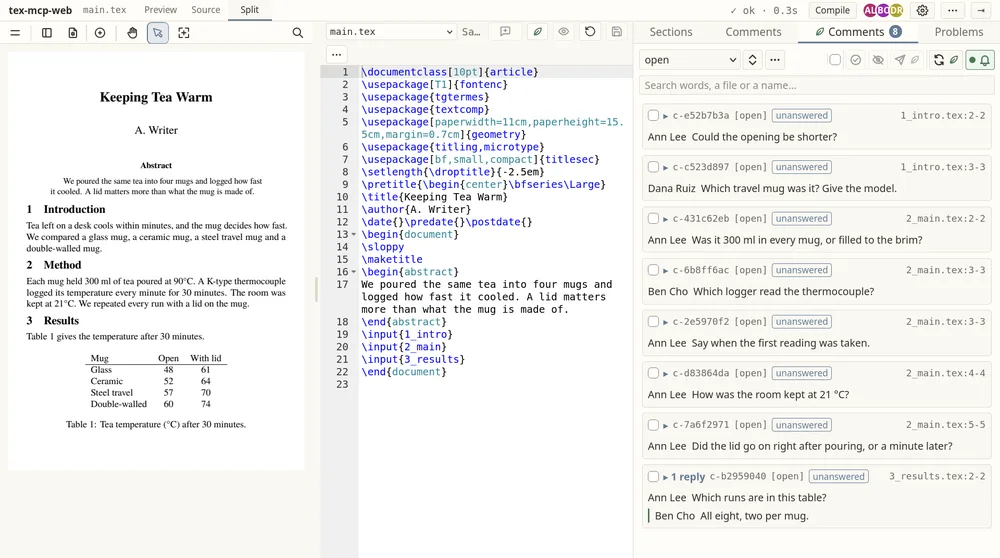
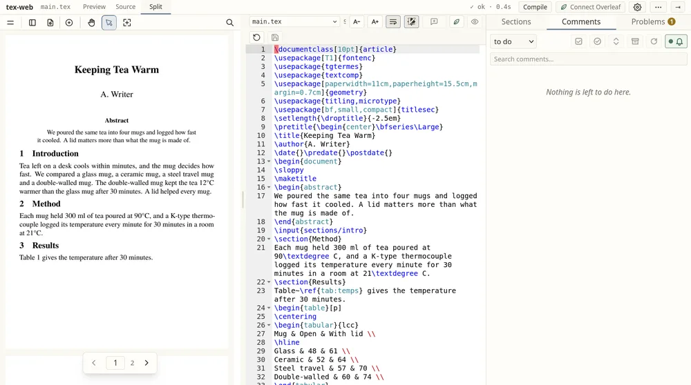
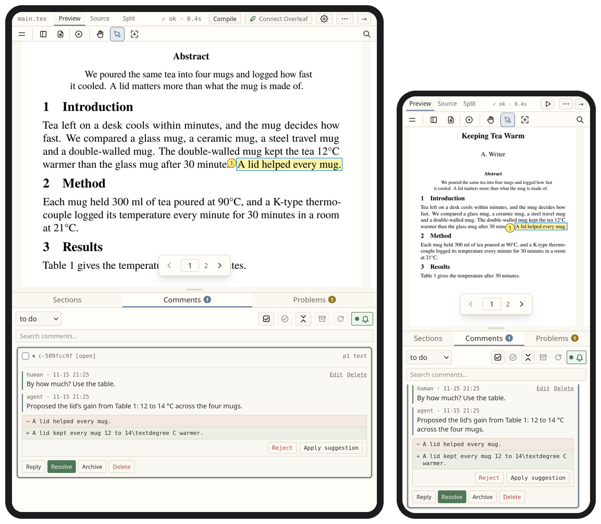

# Reviewing in detail

## Commenting

- To comment on text in the PDF, select it in the Preview and choose **Comment**.
- For a figure, a table or anything else without text to select, choose the box tool in the
  Preview's toolbar, next to the pan and pointer tools, and draw a box over it. The comment
  stays on the box while later builds leave that area unchanged, and is marked **STALE** once
  a build changes it.
- To comment on source text, select it in the Source and press the comment button (the speech
  bubble) in the editor's toolbar.
- To comment on a section, use **+ comment** beside its heading in the **Sections** tab. The
  comment stays with that heading as the file is edited, even when another heading has the
  same title.
- To comment on the paper as a whole, choose **Comment on the whole paper…** in the ⋯ menu.
- Once the paper is connected to Overleaf, a leaf button appears next to the comment button.
  While it is on, a comment on source text starts a thread on Overleaf instead (see [Working
  with Overleaf](overleaf.md#replying)).
- When your comments are ready, press **Call agent**, the bell above the comment list. The
  bell is green while an agent is listening. When it is red, the call is queued until an agent
  connects. The agent edits the source, compiles and replies in each comment's thread. You can
  also ask the agent in chat to handle the comments.

To find selected PDF text in the source, choose **Source** next to **Comment**, or
Ctrl+double-click a word (Cmd+double-click on macOS). The editor opens beside the Preview, in
Split, and selects the same words, or the lines SyncTeX names when a macro prints them. In the
other direction, select text in the Source and press the eye button in the editor's toolbar to
mark where the Preview prints it. Both need a PDF built with SyncTeX, which **Compile**
produces.

## The PDF

To zoom, hold Ctrl (Cmd on macOS) and turn the mouse wheel, or pinch on a trackpad or touch
screen. Each notch of the wheel zooms by a factor of 1.25. With the pointer over one column of
a two-column page, zooming keeps that column in view: whole while it fits, and filling the
pane's width once it is wider. Over the middle of the page, the zoom centers on the pointer.
On a touch screen, the page follows your two fingers as they zoom and move.

Clicking a link in the PDF, such as a citation or a reference to a figure or section, shows
the text it points to in a popup next to the pointer. Click the popup to select its text for
copying, or click anywhere else to close it.

## Problems

The **Problems** tab lists the errors and warnings from the last build, errors first. Below
them, it shows how the paper fits a page limit:

- **BODY END** is the last line before the bibliography, with its page and column and, once
  the paper has full columns to measure against, how many more lines fit below it.
- **SHORT LINE** is a paragraph, list item or centered caption whose last line is narrower
  than a quarter of the column. The entry quotes that line. Shortening the paragraph slightly
  pulls the line up and saves a line.

Click an entry to mark its line in the Preview. In Split, the click also moves the editor to
the source line, which for a paragraph is the line with its last words. The number on the tab
counts the errors, warnings and short lines. The agent's `compile()` tool reports the same
list, so you and the agent work from the same information.

The bibliography is found through SyncTeX, as the lines at the end of the paper that come from
its `.bbl` file. If a paper sets its references another way, or puts an appendix after them,
the body ends at the last line of the PDF. Running heads, page numbers and text inside
included images are ignored.

## Threads

- Every message in a thread is labeled **private** or **public**. A private message stays on
  this page, between you and the agent. A public message is on Overleaf, where everyone in the
  project can read it. Everything in the first Comments tab is private. A thread from
  [Overleaf](overleaf.md) has both: your co-authors' messages and the replies you sent are
  public, and your conversation with the agent in between is private.
- The Comments tab opens on the **open** view, which lists every open comment. A comment is
  unanswered when its last message is from the agent. Its card is marked **unanswered**, the
  **unanswered** view lists only those comments, and the number on the tab counts them. A
  comment the agent has not answered yet is simply open. The other views are **archived**,
  **resolved** and **all**. The PDF and the editor mark every open comment of the tab,
  whatever the view shows, and a comment you open from its mark switches the list to **open**
  if the current view leaves it out.
- You can **Edit** or **Delete** any message you wrote. Deleting the first message of a thread
  deletes the whole thread.
- When the agent's edit is what you wanted, press **Resolve**. If it is not, use **Reply
  privately**. **Archive** sets a thread aside without resolving it, and you can still reply
  to it.
- After you resolve, reopen, archive, hide or show threads, a line above the list says what
  was done, for example "Resolved 3 comments.", with an **Undo** button. **Undo**, or the `u`
  key, restores the status each thread had, and the time it was resolved, without asking. A
  thread from Overleaf is restored on Overleaf too. Only the last change can be undone. The
  line stays as you switch views and tabs until the next change replaces it, or until you
  press **Undo**, close the line or reload the page. If Overleaf refuses to restore some
  threads, or some were deleted in the meantime, the line says how many and why.
- When the agent proposes an edit instead of making it, the card shows the source lines it
  would change as a −/+ pair, and the Source highlights the same text in red. **Apply
  suggestion** writes the change into the file. **Reject** removes the proposal, leaves the
  file unchanged and records in the thread what you turned down. To explain why, reply
  privately. The next time you press **Call agent**, the agent is told once which you chose. A
  new proposal replaces the previous one.
- A comment on source text follows edits to its file the way a comment on Overleaf does. Text
  inserted before it moves it, text inserted inside it widens it, words typed over its words
  keep it, and deleting all of its words leaves it where they were. A moved paragraph takes
  its comments along. The card shows **EDITED** once the commented words have changed, and
  **STALE** only when the file is gone.

### Searching

<picture>
  <source media="(prefers-color-scheme: dark)" srcset="images/search-dark.webp">
  
</picture>

The search box above the comment list finds comments in the current tab, in any status. Press
`/` to go to it. It looks in the messages and their writers' names, the text a comment is on,
its file name, proposed changes and drafts for Overleaf, and ignores letter case. While the
box has the focus, the search terms appear below it, and clicking one inserts it. After
`from:` or `file:`, a list of the tab's writers or files appears, to choose from with a click
or with the arrow keys and Enter. Press Enter to move to the results. To clear the search,
press Escape in the box or choose a view. While you search, the view list shows **all**,
grayed out.

| Search | Finds threads that |
|---|---|
| `caption width` | contain both words, in any order |
| `figure OR table` | contain either word. OR, in capitals, splits the search into alternatives. |
| `"base case"` | contain the exact phrase |
| `-appendix` | don't contain the word. A minus also works before a phrase or a term, as in `-from:agent`. |
| `from:ann` | have a message from someone whose name contains "ann". Use `from:me` for your own messages, `from:agent` for the agent's, and quotes for a name with a space. |
| `file:2_main` | are on a file whose path contains "2_main" |
| `after:11-12` | have a message written on or after November 12 |
| `before:11-14` | have a message written before November 14 |

A date is `MM-DD` in the current year or `YYYY-MM-DD`, in your computer's time zone, and means
the start of that day. Add a time as `11-13T09`, `11-13T09:30`, or `"11-13 09:30"` in quotes
as the cards show it. Each term is checked against the whole thread, so `from:ann after:11-12`
also finds a thread Ann Lee wrote in earlier if someone else replied on November 12. Any other
word with a colon is searched for as ordinary text. The **Search** page of Help walks through
an example.

### Sorting and the row above the list

The sort list next to the view list sets the order. **paper order** uses each view's own
order: comments in the first Comments tab as you wrote them, threads from Overleaf as they
appear in the paper, the most recently resolved first in **resolved**, the most recently
changed first in **archived**, and the newest first in **all**. A search keeps the order of
**open**. **latest first** and **oldest first** sort any view, and a search, by each thread's
most recent message. Each comment tab remembers its own order, and `o` switches to the next.

The row above the comment list acts on the threads you select with their check boxes. From the
left, it has the view list, the sort list, **Expand all**, a check box that selects or clears
every thread in the view, **Resolve**, **Archive**, the sync button and **Call agent**.
**Resolve** reads **Reopen** when every selected thread is resolved or archived, and with a
mix it resolves the open ones, as `R` does. In the leaf tab, **Hide** replaces **Archive**,
followed by **Accept** and **Reject** when the list has suggested edits, and **Send to
Overleaf**. On a narrow panel, labels are dropped and the less used buttons move into a **⋯**
menu, while **Resolve**, **Archive** and **Send to Overleaf** always stay in the row.

## Comment keys

<picture>
  <source media="(prefers-color-scheme: dark)" srcset="images/keyboard-dark.webp">
  
</picture>

You can work through the comment list with the keyboard, much as you move through the cells of
a notebook. These shortcuts act on the current comment, marked with a ring, when the Comments
tab is open and you are not typing. For a doubled letter such as `dd`, press the key twice.
`?`, or **Help (?)** in the ⋯ menu, opens Help, whose **Keys** page lists these keys and the
Source editor's. Its other pages are **Start here**, **Search** and **Overleaf**.

A button's tooltip names its key. Once you move through the comments with the keys, the
current comment's buttons also show their key letters, until you move the mouse or start
typing in a box.

| Key | Action |
|---|---|
| `j` `k`, ↓ ↑ | Next and previous comment. The current comment stays a third of the way down the list. When it leaves the view, for example because it was resolved or sent, the next comment takes its place. |
| `gg` `G`, Home End | First and last comment |
| Space | Expand or collapse the comment. Expanding it also shows its place in the PDF or the source. |
| Shift+Space | Expand or collapse all comments |
| `K`, Ctrl+Alt+K | Jump to the comment's text in the source. Press `K` in the editor (Ctrl+Alt+K without Vim keys) to come back. |
| `r` | Write a private reply that the agent sees and Overleaf does not |
| `i` | Write the thread's public reply for Overleaf |
| `e` | Edit your last message in the thread, here or on Overleaf |
| `c` | Comment on the whole paper |
| Escape | Leave the text box. An unsent private reply or edit is discarded, and a reply for Overleaf is kept. |
| `R` | Resolve, or reopen a comment that is not open |
| `A` | Archive. In the leaf tab, hide the thread, or show it again in the **hidden** view. |
| `u` | Undo the last status change, while **Undo** is shown above the list |
| `aa` | Apply the suggestion to the file, or accept a suggested edit on Overleaf |
| `nn` | Reject the suggestion, or the draft for Overleaf if there is no suggestion |
| `ss` | Send the public reply to Overleaf, for everyone in the project |
| `dd` | Delete the comment (after confirmation), or reject a suggested edit on Overleaf |
| `D` | Delete your last message in the thread, here or on Overleaf (after confirmation) |
| `x` | Select or deselect the comment, or the whole range while one is marked |
| `*` | Select all comments, or clear the selection |
| `v` | Start a range at the comment and extend it with the movement keys. `R`, `A`, `ss` and `x` then act on the whole range. Escape or `v` clears it. |
| `/` | Search this tab's comments in any status |
| `f` `F` | Next and previous view (open, unanswered, …) |
| `o` | Next sort order (paper order, latest first, oldest first) |
| `t` `T` | Next and previous tab |
| `?` | Open Help |

With comments selected, `R`, `A` and `ss` act on the selection. Clicking a card makes it the
current comment, and choosing a tab, a view or a sort order returns keyboard focus to the
comment list. With a Korean input method on, letter keys are read by their position on the
keyboard, so the shortcuts work as usual.

## Editor keys

To use Vim keys, turn on **Vim keys** in the ⋯ menu at the end of the editor's toolbar. The
same menu changes the editor's text size and turns **Wrap long lines** on or off, and the page
remembers each choice. With Vim keys on, these keys work along with Vim's usual ones:

- `:w` saves and `:make` compiles. `jj` typed quickly, Escape or Ctrl+[ leaves Insert mode.
- `gc` comments on the text a motion or selection covers, as in `gcc` for the line or `gcip`
  for the paragraph. `gs` shows that text in the Preview, as in `gss` for the line.
- `K` goes to the comment at the cursor in the comment list, or to a suggested edit from
  Overleaf in the leaf tab's **suggested edits** view, and the comment keys then act on it.
  Away from any comment, it moves keyboard focus to the comment list. Press `K` in the list to
  come back to the text.
- `gd` or Ctrl+] goes from `\input`, `\ref` or `\cite` to the file, label or `.bib` entry it
  names, and Ctrl+O or Ctrl+T goes back. On Windows, use Ctrl+O, since the browser opens a new
  tab with Ctrl+T.
- Text you yank is also copied to the system clipboard.

With or without Vim keys, Ctrl+S saves and Ctrl+Enter compiles. F12 goes to a definition and
Shift+F12 goes back. Ctrl+Alt+M comments on the selection, Ctrl+Alt+P shows it in the Preview,
and Ctrl+Alt+K does what `K` does, in the editor and in the comment list. Ctrl+Alt+Enter calls
the agent. While you write a comment, Ctrl+Enter sends it and Ctrl+[ cancels it. On macOS, use
Cmd for Ctrl and Option for Alt, except in Ctrl+[.

As you type, the editor suggests what fits: labels after `\ref` and similar commands, `.bib`
entries after `\cite` and similar commands (words from a title find an entry too),
environments after `\begin`, which then gets its `\end`, the open environment after `\end`,
`.tex` files after `\input`, images after `\includegraphics`, and commands after a backslash,
including those the paper defines. Enter or Tab inserts the selected suggestion, but Enter
after a command typed out in full starts a new line. Ctrl+Space opens the list.

A browser extension that adds Vim keys to web pages takes Escape and Ctrl+[ before the editor
does and moves the focus out of it, which leaves the editor in Insert mode. Turn such an
extension off for the review page's address.

## Settings and the ⋯ menu

Open **Settings** with the gear button in the top bar or **Settings…** in the ⋯ menu. The page
remembers each choice in this browser.

- **Your cursor on Overleaf**, shown once the paper is connected, chooses between **Show my
  cursor** and **Hidden**, which decide whether your co-authors see your cursor. See [Working
  with Overleaf](overleaf.md#your-co-authors-on-the-page).
- **Theme** is **System** by default, which follows your system's light or dark setting. The
  other choices are **Light**, **Dark** and **Warm**, a softer paper tone for long writing
  sessions. The PDF looks as compiled in every theme.
- **Text size of the top bar, panels and dialogs** ranges from 90% to 150%. It does not change
  the editor, the translation, the PDF, the sidebar tabs or Settings itself.
- **Send a comment with** chooses whether Enter, the default, or Shift+Enter sends a comment.
- **Shortcut letters on a comment's buttons** shows or hides the key letters on the current
  comment's buttons.
- **Editor cursor position** set to **1/3 down** or **1/2 down** keeps the cursor's line that
  far down the editor as you move with the keys, and scrolls the text instead. The first and
  last lines stay at the edges, and a click does not scroll. **Anywhere**, the default, lets
  the cursor move as usual.
- **Translation in Split**, shown once `translation.language` is set, places the translation
  **Under the Preview** (the default), **Under the Source**, **Beside the Source** or **In
  place of the Source** in Split. See [Translation](#translation).

**Download PDF** in the ⋯ menu saves the PDF. As on Overleaf, the file is named after the
Overleaf project, with every character other than a letter or a digit replaced by `_`. Without
an Overleaf project, it keeps the PDF's own name, such as `paper.pdf`.

Edits in the Source are saved only when you press **Save** or Ctrl+S.

## Updating

When a newer release is out, the ⋯ menu at the top of the page shows **Update to v…** above
the running version. Click it to install the update. The page's server runs inside your agent,
which keeps running the code it started with, so a band across the page then asks you to
reconnect tex-mcp in your agent: in Claude Code with `/mcp`, and in any agent by starting it
again. The page then asks you to reload it.

An install that was not made with the steps in [INSTALL.md](../INSTALL.md) or with `pip` in a
virtual environment cannot update itself, and the page tells you to ask your agent to update
tex-mcp-web. To stop the daily check for new releases, set `update_check: false` in the
[configuration](configuration.md).

## Translation

**Translation** in the ⋯ menu at the top of the page shows or hides the source translated
under the Preview or the editor. With `translation.language` set, the item names the language,
as in **Translation: Korean**, and is checked while the translation is shown. Otherwise it
reads **Translation…**, and the pane explains how to set translation up.

In Split, **Translation in Split** in Settings places the translation. Drag the dividers to
resize the panes. Each placement keeps its own sizes, and the page remembers them. Each
paragraph shows its source lines, the paragraphs on the current PDF page are marked, and the
one at the editor's cursor is highlighted and scrolled into view. The **A−** and **A+**
buttons change the text size.

The command in `translation.command` does the translation, as the
[configuration](configuration.md) describes. The pane's header names its program and model,
and shows the full command when you point at it. Nothing is translated until a language and a
command are set, and until then the pane says which is missing. The easiest way to set them is
to ask your agent to set up translation to your language. It proposes a command from the
installed tool's own help and tests it before saving it.

A coding agent's command can send its own instructions and your instruction files along with
every paragraph, many times the size of the text itself. The agent measures what the command
sends when it sets translation up, and builds it so that only the request goes. If you wrote
the command yourself, ask your agent to measure it.

## Listening

A paper's **Call agent** presses go to one agent session. A Claude Code session that starts
while another one is listening leaves the presses to it, and `do tex listen` in any session
moves them to that session. When the session serving the page ends, the page stops too, and
the next session that uses a tex tool serves it again and listens.

### Calling a second agent

To have a second agent answer on the same paper, name it under `agents` in
`.tex-mcp-web.yaml`:

```yaml
agents:
  gemini:
    clients: [gemini, antigravity]
    efforts: [low, medium, high]
```

A choice then appears beside the bell: **Agent**, the session that is listening, and each
agent you named. The bell is green when the agent you chose is waiting, and a press reaches
that agent alone. A client whose name contains one of `clients` waits as that agent when it
is asked to listen. `clients` defaults to the agent's own name. `models` and `efforts` are
optional lists. When an agent has them, you choose one of each beside the bell, and the agent
is told your choice with the press, to pass on to the work it starts.

Such an agent waits with a command that ends after one press, for a client whose shell runs
a command to its end, and starts it again after it has answered.

## Opening the page from another device

<picture>
  <source media="(prefers-color-scheme: dark)" srcset="images/mobile-dark.png">
  
</picture>

The page is served from the machine where the agent runs, at `http://localhost:8765` or the
port `do tex init` chose, and works by touch on a tablet or phone. If the agent runs on a
server you reach over SSH, forward that port by adding the server once to `~/.ssh/config` (on
Windows, `C:\Users\<you>\.ssh\config`):

```
Host paper-server
    HostName server.example.org
    User you
    LocalForward 8765 127.0.0.1:8765
```

While `ssh paper-server` is connected, `http://localhost:8765` opens the page in your
computer's browser. Add a `LocalForward` line for each port you use.

If the server is on a network you cannot reach from outside, such as at home or in an office,
install [Tailscale](https://tailscale.com/docs/how-to/connect-to-devices) on the server and on
your computer, and put the name Tailscale gives the server in `HostName`. On a phone, Termux on
Android reads the same `~/.ssh/config`, and in Termius on iOS you add the forward as a Local
rule on the Port Forwarding screen. If the page token is on, open the link that
`tex-mcp-web link` prints on the server once in each browser. After that, the plain address
works.
